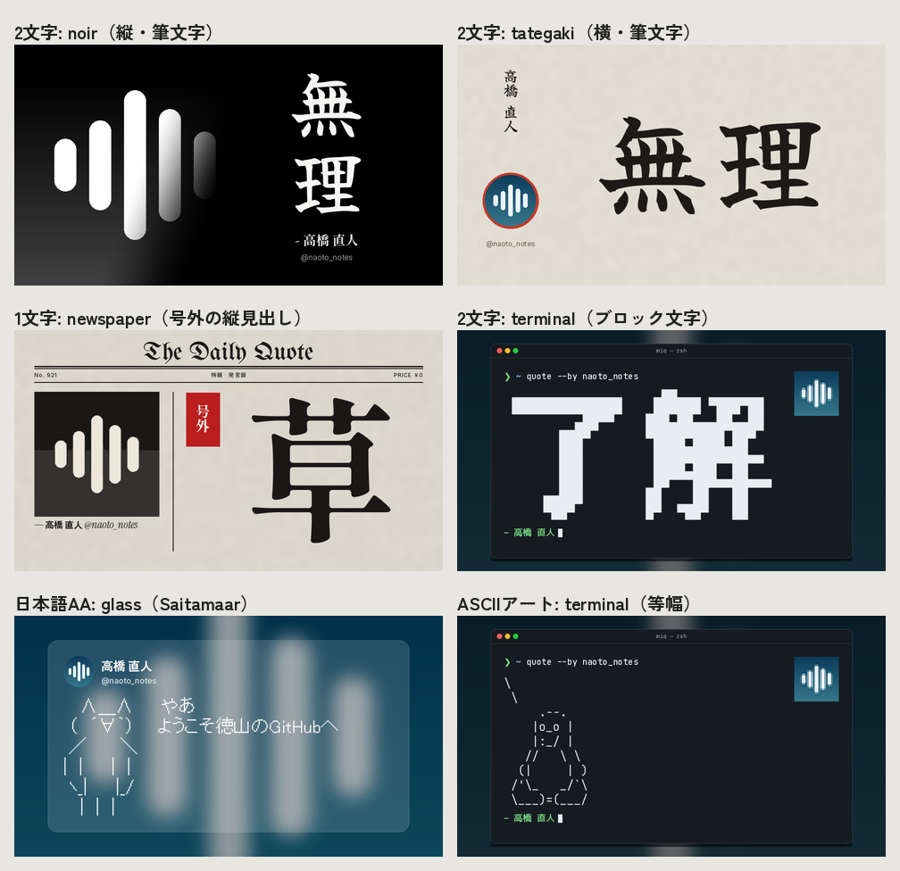

# MIQ Generator

Discordで返信に `miq` と打つと、返信先のメッセージとアイコンから名言画像を作る ——
その画像を描くための、オフラインのPython描画器です。


- **10種類の構図を等確率（各10%）で抽選**します。
- 短い一言が映えるように調整しつつ、長文も省略せず全文を収めます。
- 1〜2文字（「草」「無理」など）は筆文字や縦組みで大きく描きます。
- **アスキーアート（AA）をずらさず**に描きます。日本語AAは MS Pゴシック互換の Saitamaar、ASCIIアートは等幅フォントを使います。
- 既定は960x540。旧版（640x360）より画素は2.25倍ですが、描画は旧版より速くなっています（[速さ](#速さ)）。
- 描画にネット接続・画像生成AI・外部APIは不要です。

## 目次

- [10種類の構図](#10種類の構図)
- [短い文・1〜2文字・長文](#短い文12文字長文)
- [アスキーアート（AA）](#アスキーアートaa)
- [フォント](#フォント)
- [導入](#導入)
- [CLI](#cli)
- [Python / Discord Bot](#python--discord-bot)
- [速さ](#速さ)
- [構成](#構成)
- [検証](#検証)
- [ライセンスと注意](#ライセンスと注意)

## 10種類の構図

`--layout auto`（既定）は下の10構図から各10%で選びます。`--layout` で固定でき、`--seed` で抽選を再現できます。

| # | 名前 | 内容 |
| --- | --- | --- |
| 1 | `noir` | 白黒のアイコンが**斜めの境界**で黒へ溶ける Make it a Quote 風。明朝の本文と斜体の署名 |
| 2 | `spotlight` | 旧 classic の後継。アイコンを上下いっぱいに置き、アイコンの主色で光と罫を入れる |
| 3 | `mirror` | アイコンを右に置き、境界を逆向きの斜めにした構図。太字の左揃えにアクセントの縦線 |
| 4 | `tategaki` | 和紙に**筆文字の縦書き**。朱の輪で囲んだアイコンと縦組みの署名 |
| 5 | `cinema` | 映画の一場面。シネスコの黒帯、字幕、帯の中のクレジット、フィルムの粒子 |
| 6 | `glass` | ぼかしたアイコンの上に半透明のカード。SNS投稿風のヘッダー |
| 7 | `poster` | アイコンの主色を地にしたスイス風ポスター。極太の Dela Gothic One とデュオトーン |
| 8 | `newspaper` | 新聞の一面。ブラックレターの題字、網点（ハーフトーン）の写真、明朝の見出し |
| 9 | `terminal` | アイコンをぼかした壁紙の上のターミナル。引用をコマンドの出力として表示し、窓は内容に合わせて伸縮 |
| 10 | `cover` | 雑誌の表紙。全面のアイコン、題字、下部に重ねた引用 |

旧名の `classic`→`spotlight`、`mirrored`→`mirror`、`magazine`→`cover`、`literary`→`tategaki` も指定できます。


アクセントの色は、アイコンから主色を取り出して決めます。アイコンごとに色が変わります。

## 短い文・1〜2文字・長文

| 本文 | 扱い |
| --- | --- |
| **1〜2文字**（漢字・かな・絵文字） | 普段横書きの構図では**縦に大きく**、縦書きの `tategaki` では**横に大きく**描きます。noir・mirror・cover・tategaki は筆文字（Yuji Syuku）を使います。newspaper は赤い「号外」付きの縦見出し、cinema は右端の縦字幕、terminal はブロック文字のバナーになります |
| 短い文（24字以下・1行） | 各構図で大きく組みます。glass は中央揃え、tategaki は筆文字の縦書きで、2〜3行程度の長い列にまとめます |
| 長文 | **文字数上限・最低フォントサイズはありません。** 縦横比を保って全文を縮小し、縦だけの圧縮や末尾の省略はしません。tategaki は明朝の縦書きに切り替え、欧文中心・RTLの本文は横組みにします |



改行のルール:
- 日本語は単語と付属語、欧文は単語、絵文字は結合列をまとめて改行します。
  例えば「じゃあ8時間ホモにな／るか」は「じゃあ8時間ホモに／なるか」になります。行の長さは均等に近づけます。
- 縦書きは行頭・行末禁則、句読点のぶら下げ、2〜3桁の英数字の縦中横、長い欧文の90度回転に対応します。
- 長いURLや単語も途中で割りません。その語が収まるまで全体を縮小します。
- アラビア語・ヘブライ語の双方向表示、インド系文字の連結、他言語のフォント補完はPangoで処理します。
- Unicode絵文字は色付きです。肌色、国旗、ZWJ、キーキャップにも対応します。Discord独自絵文字は、IDに対応する画像を渡します。
- `--attachment` は添付画像を切り抜かずに置きます。全面系の構図では、余白をぼかした同じ画像で埋めます。


## アスキーアート（AA）

複数行で記号や空白の並びが多い本文、またはDiscordのコードブロック（```` ``` ````）は、AAとして扱います。
AAは改行・空白・字間を一切変えず、1つの絵として縮小してから配置します。

| 種類 | 判定 | フォント | ずれない理由 |
| --- | --- | --- | --- |
| 日本語AA（SJIS AA） | ASCII・罫線以外の文字（全角・半角カナなど）を含む | Saitamaar | MS Pゴシック12pt（16px）と同じ文字幅です。16pxの倍数では全文字の幅が整数pxになるため、そのサイズで描いてから全体を縮小します。行送りは2ch標準の18px相当です |
| ASCIIアート | ASCII・罫線・ブロック要素のみ | JetBrains Mono | 等幅です。合字（`->` など）は無効にしています |

- 全行に共通する半角空白のインデントだけを取り除きます。相対位置は変わりません。
- Saitamaar は半角 `\` を MS Pゴシック同様に `¥` で描きます。Discordでは `\` と見えるため、同じ幅のバックスラッシュ（U+2216）に置き換えます。
- 検証には、GitHub上の実際のAA（モナー、cowsay の tux・dragon）を使っています。出典は `tests/aa/SOURCES.md` にあります。

## フォント

ゴシック一辺倒をやめ、構図ごとに和文と欧文を組み合わせています。

| 用途 | 和文 | 欧文 |
| --- | --- | --- |
| 明朝（noir / newspaper / 長文の tategaki） | しっぽり明朝 B1 ExtraBold | Instrument Serif |
| 筆文字（1〜2文字、短文の tategaki、署名） | Yuji Syuku | Instrument Serif |
| ゴシック（spotlight / mirror / glass / cinema / cover） | Zen角ゴシック New Bold・Medium | Inter（可変） / Instrument Serif Italic |
| 極太（poster） | Dela Gothic One | Dela Gothic One |
| 等幅（terminal） | M PLUS 1 Code | JetBrains Mono |
| AA | Saitamaar | Saitamaar / JetBrains Mono |
| 署名・題字 | — | Cormorant Garamond Italic、Anton、UnifrakturMaguntia |

フォントに無い文字は、同梱の Noto Sans JP とシステムの Noto フォントで補います。絵文字は Noto Color Emoji です。
`--font` / `--bold-font` / `--italic-font` で本文・署名・欧文のフォントを差し替えられます。

## 導入

Python 3.10以上、Linux（またはDocker）。

```bash
sudo apt-get install libpango-1.0-0 libpangocairo-1.0-0 libcairo2 libfontconfig1 \
  fonts-noto-core fonts-noto-cjk fonts-noto-color-emoji
python -m venv .venv
source .venv/bin/activate
pip install -r requirements.txt
python scripts/setup_fonts.py
```

`setup_fonts.py` は、`scripts/fonts.json` に記録したフォントを固定コミットから一度だけ取得します。
取得時に SHA-256 を確認し、ライセンス文書も保存します。フォント本体はGitに含めません。
より広い文字種が必要なら `fonts-noto-extra` も導入してください。
Windows/macOS でも同じPython APIを使えますが、Pango/Cairo/Fontconfig を別途導入する必要があります。

Docker:

```bash
docker build -t miq-generator .
docker run --rm --network none -v "$PWD:/data" miq-generator \
  --avatar /data/demo-avatar.png --text '小さな発見が、明日を変える。' \
  --name '投稿者' --output /data/quote.png
```

## CLI

```bash
python miq.py --avatar avatar.png --text '引用したい本文' \
  --name '表示名' --handle 'username' -o quote.png

# 構図の固定・添付画像・UTF-8本文ファイル・HD出力
python miq.py --image photo.jpg --attachment --text-file quote.txt \
  --layout tategaki --size 1920x1080 -o quote.png
```

| オプション | 説明 |
| --- | --- |
| `--avatar`, `--image` | 画像パス（必須）。PNG/JPEG/WebP/GIF など Pillow が読める画像 |
| `--text`, `--quote` / `--text-file` | 本文、またはUTF-8のファイル。どちらか一方が必須 |
| `--name`, `--handle` | 表示名とユーザー名（省略可） |
| `--output`, `-o` | 出力先。既定は `quote.png`。拡張子が `.jpg` / `.webp` ならその形式で保存 |
| `--size` | `960x540`（既定）、`1280x720`、`1920x1080` など（200x120以上） |
| `--layout` | `auto`（既定。10構図から等確率）、構図名、または旧名 |
| `--seed` | 自動抽選に使う整数シード |
| `--attachment` | アイコン用の切り抜きをせず、添付画像として配置 |
| `--align` | `spotlight` の本文位置。`right`（既定）または `center` |
| `--font`, `--bold-font` | 本文・署名の和文フォントを差し替え |
| `--italic-font` | 本文の欧文フォントを差し替え |
| `--emoji-font` | 絵文字フォントを指定 |

環境変数の `MIQ_SIZE`、`MIQ_TEXT_ALIGN`、`MIQ_FONT`、`MIQ_EMOJI_FONT`、`MIQ_ITALIC_FONT` も使えます。

## Python / Discord Bot

```python
import asyncio, io
from pathlib import Path
from miq import render, warmup

warmup()  # Bot起動時に1回。フォント・日本語辞書・マスクを読み込み、初回の遅延を無くす

buffer = io.BytesIO()  # ファイルを介さずPNGを受け取れる
await asyncio.to_thread(
    render, Path('avatar.png'), message.content, buffer,
    author.display_name, author.name,
    custom_emojis={'123': Path('wave.png')},
)
buffer.seek(0)  # discord.File(buffer, 'quote.png') で送信

# 添付画像をアイコンの代わりに使う・構図を固定する
render(Path('photo.jpg'), '本文', Path('quote.png'), '表示名',
       attachment=True, layout='cinema')
```

- 既存の位置引数と戻り値（`None`）は従来のままです。`output` にはパスのほか、`BytesIO` などのバイナリファイルも渡せます。
- `layout`、`seed`、`attachment` はキーワード専用の引数です。
- フォント・入力・固定の構図・ライブラリのバージョンが同じなら、同じ画像を再生成できます。
- このリポジトリにDiscordのコマンド受信部分は含まれていません。返信で `miq` を受け取るBot側から、返信先の本文・表示名・ユーザー名・アイコン（または添付画像）を渡してください。
- **Botのプロセス内で `render` を呼んでください。** 毎回 `python miq.py` を起動すると、Pythonと日本語辞書の読み込みで1枚あたり約0.4秒余計にかかります。
- アイコンは `display_avatar.with_size(512)` 程度で十分です。大きすぎる画像は読み込みだけで遅くなります。
- 独自絵文字はBot側で保存し、`custom_emojis` に渡します。画像が無い独自絵文字は `:name:` と表示します。
- AAを送るときは本文（コードブロックの ```` ``` ```` も含めて）をそのまま渡してください。

## 速さ

`python scripts/benchmark.py` の結果です（4コアのLinux、ウォーム時の中央値。旧版は旧ベンチマークの同じ本文で計測）:

| | 旧版（640x360） | 新版（960x540） |
| --- | --- | --- |
| 通常の本文 | classic 29ms / 他の3構図 96〜105ms | 全10構図 14〜25ms（全体の中央値 20ms） |
| 長文 | classic 72ms / 他の3構図 394〜1073ms | 27〜56ms |
| 1280x720 で出力した場合 | — | 中央値 32ms |
| CLIを1回起動した場合 | 約0.8秒 | 約0.4秒 |

主な最適化:
- 1920x1080で描いてから縮小していた構図を、出力サイズで直接描くようにしました。
- 和文の字形と寸法をグリフ単位で、固定の見出し（題字など）を描画済みマスクとしてキャッシュし、FreeTypeの再描画を省いています。
- 不透明な画像はRGBのまま処理します。拡大はbicubic/bilinear、縮小のときだけLANCZOSを使います。
- 暗幕・ビネット・グラデーション・角丸などのマスクは、サイズごとにキャッシュしています。複数の暗幕は1回の乗算にまとめています。
- PNGはUpフィルタをCで計算し、deflateを複数スレッドで並列に実行します（可逆な標準PNGです）。
- Pango/Cairoは、RTLなど複雑な文字列を描くときだけ読み込みます。フォントの文字表はディスクにキャッシュしています。

## 構成

| ファイル | 役割 |
| --- | --- |
| `miq.py` | CLI、`render()`・`warmup()`、構図の抽選、保存 |
| `miq_layouts.py` | 10構図と描画部品（本文の配置、署名、影、1〜2文字の描画） |
| `miq_text.py` | 文字の計測・改行・縮小、絵文字、グリフのキャッシュ |
| `miq_vertical.py` | 縦書き（禁則、ぶら下げ、縦中横、列の均等化） |
| `miq_aa.py` | AAの判定と、ずれない描画、ブロック文字バナー |
| `miq_images.py` | 画像の配置、マスク・質感・網点、PNG出力 |
| `miq_complex.py` | Pango/Cairoによる双方向・複雑な文字列 |
| `miq_words.py` | 単語・書記素の境界（Janome） |
| `miq_fonts.py` | フォントの役割、探索、文字表のキャッシュ |
| `scripts/` | フォント取得（`setup_fonts.py`・`fonts.json`）とベンチマーク |
| `tests/` | テスト一式と、実際のAAの検証データ（`tests/aa/`） |

## 検証

```bash
pip install pytest
python -m pytest -q
python scripts/benchmark.py            # 全構図のウォーム時の描画時間とCLIの起動時間
python scripts/benchmark.py 5 1280x720 # 出力サイズを変えて計測
```

次の内容を検証しています:
- 単語単位の改行、結合文字、絵文字のキャッシュ、長文の末尾、1px未満への縮小、多言語
- 全10構図と、難しい本文（長文・RTL・独自絵文字・改行・1文字）や画像比率との組み合わせ
- 1〜2文字の扱い、縦書きの禁則と列の均等化
- AAの判定、コードブロック、MS Pゴシック互換の文字幅、全構図でのAA描画
- 等確率の抽選、旧名、BytesIOへの出力、PNGの可逆性、CLI/API、再現性、並行描画

## ライセンスと注意

- デモ画像には、リポジトリ内で合成した `demo-avatar.png` を使っています。第三者の投稿・アイコンや生成物を誤ってコミットしないよう、`quote.png` と `output/` はGitの対象外にしています。
- 本ツールは Make it a Quote 風の独自実装で、公式Botではありません。
- フォントは SIL Open Font License 1.1 です（Saitamaar のみパブリックドメイン）。詳細は `fonts/README.md` を見てください。フォントを含むDockerイメージなどを配布する場合は、取得したライセンス文書も一緒に含めてください。
