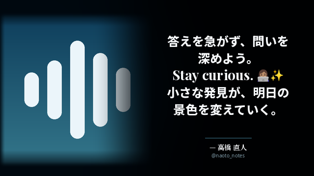
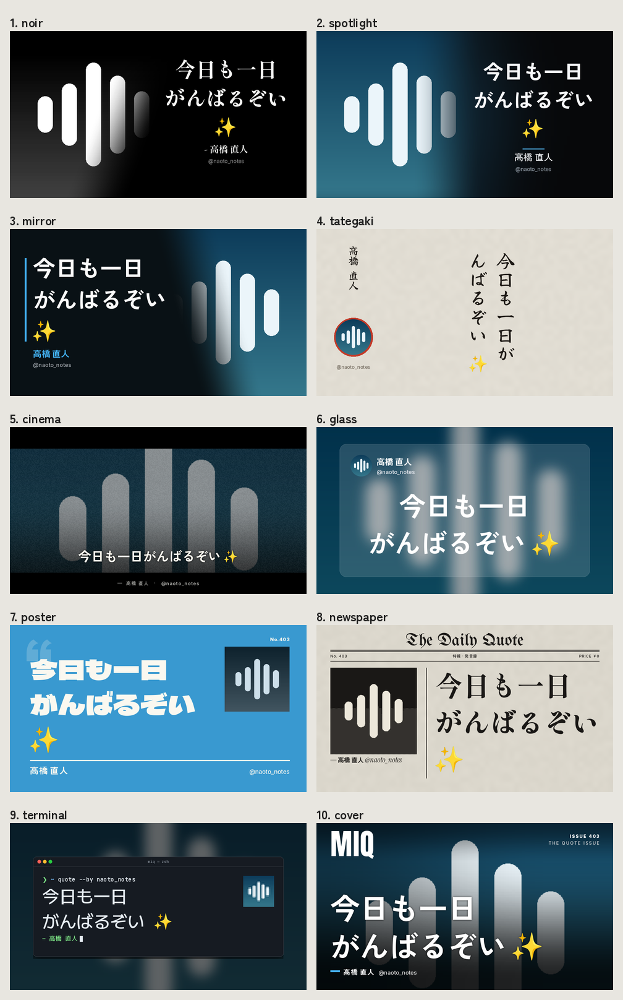
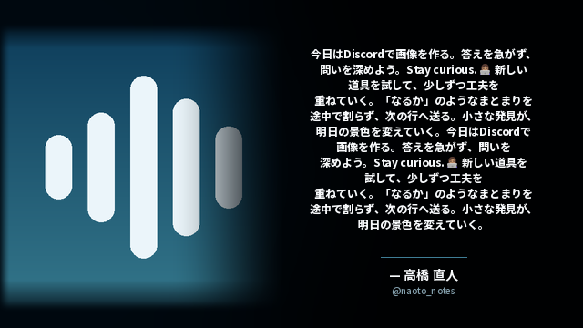

# MIQ Generator

画像と引用文からPNGを作る、オフラインのPython描画器です。Discord Botからも呼び出せます。



## 表示と改行

- 標準の抽選は **現行50% / Aの左右反転30% / Cの誌面風15% / Bのポスター風5%**。
  `--layout` で固定、`--seed` で抽選を再現できます。
- **現行50%の構成・配置を維持**し、フォントは他の構図と統一しています。
- 全4構図で Noto Sans JP ExtraBold、Playfair Display Bold、Noto Serif JP SemiBold を使います。
  欧文は斜体ではなく、太い正体セリフが標準です。
- 日本語は単語と付属語、欧文は単語、絵文字は結合列をまとめて改行します。
  例えば「じゃあ8時間ホモにな／るか」は「じゃあ8時間ホモに／なるか」になります。
- **文字数上限・最低フォントサイズはありません。** 全文を対象に、縦横比を保って縮小します。
  1px未満の文字も仮想座標で配置し、巨大な中間画像を作らず描画します。縦だけの圧縮や末尾の省略はしません。
- 長いURLや単語も途中で割らないため、その語が収まるまで全体の文字サイズが小さくなります。
  固定画素数では極端な長文は読めません。処理できる量は実行環境の時間・メモリにも依存します。
- アラビア語・ヘブライ語の双方向表示、インド系文字の連結、他言語のフォント補完はPangoで処理します。
  対応フォントが必要です。欠落する文字を検出した場合は導入を案内します。
- Unicode絵文字は色付き。肌色、国旗、ZWJ、キーキャップに対応します。
  Discord独自絵文字はIDに対応する画像を渡します。PNG出力なのでアニメーションは最初のフレームです。
- アイコンは1:1で四辺を薄くフェード。`--attachment` は添付画像の縦横比を保って配置します。



## 導入（Python 3.10以上 / Linux・Docker）

Ubuntu/Debian:

```bash
sudo apt-get install libpango-1.0-0 libpangocairo-1.0-0 libcairo2 libfontconfig1 \
  fonts-noto-core fonts-noto-cjk fonts-noto-color-emoji
python -m venv .venv
source .venv/bin/activate
pip install -r requirements.txt
python scripts/setup_fonts.py
```

`setup_fonts.py` は承認済みフォントとOFLライセンスを一度だけ取得し、固定SHA-256を確認します。
フォント本体はGitに含めません。取得後の画像生成にネット接続・画像生成AI・外部APIは不要です。
より広い文字種が必要なら `fonts-noto-extra` も導入してください。
Windows/macOSでは同じPython APIを利用できますが、Pango/Cairo/Fontconfigの別途導入が必要です。

Docker:

```bash
docker build -t miq-generator .
docker run --rm --network none -v "$PWD:/data" miq-generator \
  --avatar /data/demo-avatar.png --text '小さな発見が、明日を変える。' \
  --name '投稿者' --output /data/quote.png
```

## CLI

```bash
# 従来の引数を維持。構図を固定したい場合は --layout classic
python miq.py --avatar avatar.png --text '引用したい本文' \
  --name '表示名' --handle 'username' --layout classic -o quote.png

# 添付画像・UTF-8本文ファイル・HD出力
python miq.py --image photo.jpg --attachment --text-file quote.txt \
  --layout mirrored --size 1920x1080 -o quote.png
```

| オプション | 説明 |
| --- | --- |
| `--avatar`, `--image` | 画像パス（必須）。PNG/JPEG/WebP/GIFなどPillowが読める画像 |
| `--text`, `--quote` / `--text-file` | 本文またはUTF-8ファイル。どちらか一方が必須 |
| `--name`, `--handle` | 表示名とユーザー名（省略可能） |
| `--output`, `-o` | 出力先。既定 `quote.png` |
| `--size` | `640x360`（既定）、`854x480`、`1920x1080`など |
| `--layout` | `auto`（既定）、`classic`、`mirrored`、`magazine`、`literary` |
| `--seed` | 自動抽選用の整数シード |
| `--attachment` | アイコン用の正方形切り抜きをせず、添付画像として配置 |
| `--align` | 現行構図の `right`（既定）/ `center` |
| `--font`, `--bold-font` | 本文と表示名のフォントファイルを指定 |
| `--emoji-font` | 絵文字フォントを指定 |
| `--italic-font` | 現行構図の欧文フォントを明示的に上書き（従来オプションを維持） |

従来の環境変数 `MIQ_SIZE`、`MIQ_TEXT_ALIGN`、`MIQ_FONT`、`MIQ_EMOJI_FONT`、
`MIQ_ITALIC_FONT` も利用できます。全構図の標準フォントは `fonts/` に配置します。

## Python / Discord Bot

```python
from pathlib import Path
from miq import render

render(Path('avatar.png'), '本文 👩🏽‍💻 <:wave:123>', Path('quote.png'),
       '表示名', 'username', size='640x360',
       custom_emojis={'123': Path('wave.png')})

# 添付画像をアイコンの代わりに使う
render(Path('photo.jpg'), '本文', Path('quote.png'), '表示名',
       attachment=True, layout='mirrored')
```

`render()` の既存の位置引数と戻り値（`None`）は維持しています。
`layout`、`seed`、`attachment` はキーワード専用の追加引数です。
同じフォント・入力・固定構図・描画ライブラリのバージョンなら同じ画像を再生成できます。

このリポジトリにはDiscordのコマンド受信部分は含まれていません。返信で `miq` を受け取るBot側から、
返信先の本文・著者名・handle・アイコンまたは添付画像を渡してください。
独自絵文字もBot側で保存して `custom_emojis` に渡します。画像が渡されない独自絵文字は `:name:` で表示します。
CPU処理をイベントループで直接実行せず、`await asyncio.to_thread(render, ...)` などで呼び出せます。

## 検証

```bash
pip install pytest
python -m pytest -q
python scripts/benchmark.py   # 主要な構図の描画時間（ウォーム時）を計測
```

単語改行、結合文字、絵文字キャッシュ、長文末尾、1px未満の縮小、多言語、各構図・画像比率、
CLI/API、抽選、再現性を検証します。



デモにはリポジトリ内で合成した `demo-avatar.png` を使用しています。
第三者の投稿・アイコンや生成物を誤ってコミットしないよう、`quote.png`、`output/` はGitの対象外です。
本ツールはMake it a Quote風の独自実装で、公式Botではありません。
