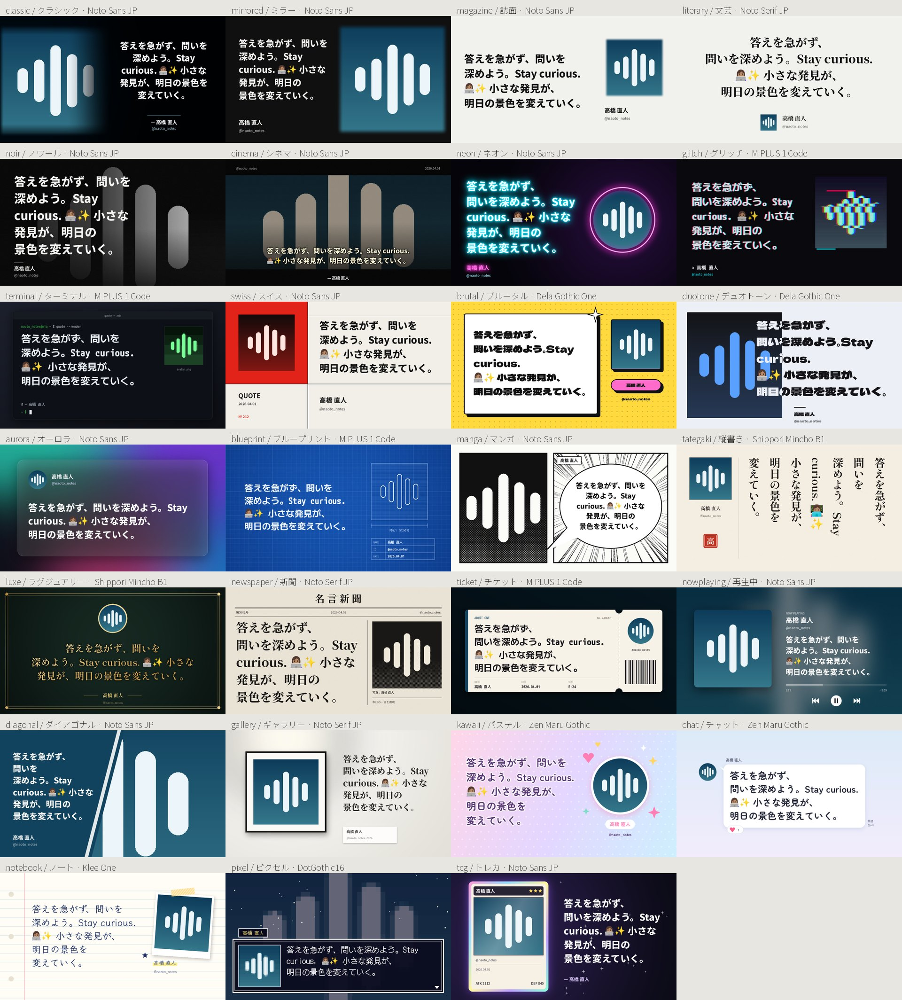

# MIQ Generator

画像と引用文からPNGを作る、オフラインのPython描画器です。Discord Botからも呼び出せます。


## 27の構図



`--layout auto`（既定）は **全27構図から均等に抽選** し、続けてその構図に合う書体を抽選します。
`--seed` で抽選を再現、`--layout` / `--font-family` で固定、`--category` で系統を絞れます。
`python miq.py --list-layouts` で一覧と各構図の書体候補を表示します。

| 系統 | 構図 |
| --- | --- |
| 定番 `classic` | `classic` クラシック / `mirrored` ミラー / `magazine` 誌面 / `literary` 文芸 |
| カッコいい `cool` | `noir` ノワール / `cinema` シネマ（字幕） / `neon` ネオン / `glitch` グリッチ / `terminal` ターミナル / `swiss` スイス / `brutal` ブルータル / `duotone` デュオトーン / `aurora` オーロラ（すりガラス） / `blueprint` 青焼き / `manga` マンガ / `tategaki` 縦書き / `luxe` 金箔 / `newspaper` 新聞 / `ticket` チケット / `nowplaying` 再生中 / `diagonal` 斜め分割 / `gallery` 美術館 |
| かわいい `cute` | `kawaii` パステル / `chat` チャット / `notebook` ノート / `pixel` RPG会話窓 / `tcg` トレカ |

- `duotone` `diagonal` `ticket` はアイコンの主色から配色を決めます。
- `tategaki` はPangoで本物の縦組み（約物・長音の縦用字形、欧文は横倒し、数字と「!?」は全角で直立、絵文字は直立）。
  欧文が半分以上・アラビア文字などの右横書き・独自絵文字・220字超の本文では、同じデザインのまま横組みにします。
- 装飾（グリッチの乱れ、集中線、星など）は本文から決まるので、同じ入力なら同じ画像になります。

## 書体

**1枚の画像の中では書体を1つに統一** します（本文・欧文・名前・handleとも同じファミリー。太さだけ変えます）。
書体は構図ごとに相性のよい候補から抽選します（例: `pixel` はドット書体、`terminal` は等幅）。

| `--font-family` | 書体 |
| --- | --- |
| `gothic` | Noto Sans JP |
| `mincho` | Noto Serif JP |
| `maru` | Zen Maru Gothic |
| `shippori` | Shippori Mincho B1 |
| `dela` | Dela Gothic One |
| `dot` | DotGothic16 |
| `code` | M PLUS 1 Code |
| `klee` | Klee One |
| `rocknroll` | RocknRoll One |

`--font` を指定するとそのフォント1つで全テキストを描きます。絵文字はカラー絵文字フォントを使います。

## 表示と改行

- 日本語は単語と付属語、欧文は単語、絵文字は結合列をまとめて改行します。
  例えば「じゃあ8時間ホモにな／るか」は「じゃあ8時間ホモに／なるか」になります。
- 禁則処理: 行頭禁止（句読点・閉じ括弧・小書き仮名・ASCIIの `)!?,.` など）、行末禁止（開き括弧）、
  「……」「——」の分離禁止、`100%の` のような数字＋記号＋助詞の一体化。
- 最終行が1〜2文字だけになる場合は前の行から1語送ります（CSSの `text-wrap: pretty` 相当）。
- **文字数上限・最低フォントサイズはありません。** 全文を対象に、縦横比を保って縮小します。
  1px未満の文字も仮想座標で配置し、巨大な中間画像を作らず描画します。縦だけの圧縮や末尾の省略はしません。
- 長いURLや単語も途中で割らないため、その語が収まるまで全体の文字サイズが小さくなります。
- アラビア語・ヘブライ語の双方向表示、インド系文字の連結、他言語のフォント補完はPangoで処理します。
  対応フォントが必要です。欠落する文字を検出した場合は導入を案内します。
- Unicode絵文字は色付き。肌色、国旗、ZWJ、キーキャップに対応します。
  Discord独自絵文字はIDに対応する画像を渡します。PNG出力なのでアニメーションは最初のフレームです。
- **Discord記法を整形します**: `**太字**` `*斜体*` `~~打消~~` `` `code` `` `> 引用` `# 見出し` の記号を外し、
  `||スポイラー||` は伏字（■）、`<@id>` `<@&id>` `<#id>` は `mentions` で渡した名前、`<t:…>` は日時に変換します。
  不要なら `markup=False` / `--raw`。

### pretext について

[chenglou/pretext](https://github.com/chenglou/pretext) はブラウザのCanvas `measureText` を前提にしたTypeScriptライブラリです。
このリポジトリはFreeType（Pillow）とPangoで描くため、そのまま組み込むと「測る書体エンジン」と「描く書体エンジン」が別になり、
改行位置と実際の描画幅がずれます。Node.jsの依存とプロセス間通信も増え、禁則処理もありません。
そこで中核の考え方（**prepare/layout の分離**: 語の分割と幅の計測を1回だけ行い、行組みは足し算だけで行う）をPythonに移植しました。
確定した行だけ実測してカーニングやはみ出しを検証し、ずれたときは実測で組み直します。

## 導入（Python 3.10以上 / Linux・Docker）

Ubuntu/Debian:

```bash
sudo apt-get install libpango-1.0-0 libpangocairo-1.0-0 libcairo2 libfontconfig1 \
  fonts-noto-core fonts-noto-cjk fonts-noto-color-emoji
python -m venv .venv
source .venv/bin/activate
pip install -r requirements.txt
python scripts/setup_fonts.py
```

`setup_fonts.py` は承認済みフォントとOFLライセンスを一度だけ取得し、固定SHA-256を確認します（合計約75MB）。
フォント本体はGitに含めません。取得後の画像生成にネット接続・画像生成AI・外部APIは不要です。
より広い文字種が必要なら `fonts-noto-extra` も導入してください。
Windows/macOSでは同じPython APIを利用できますが、Pango/Cairo/Fontconfigの別途導入が必要です。

Docker:

```bash
docker build -t miq-generator .
docker run --rm --network none -v "$PWD:/data" miq-generator \
  --avatar /data/demo-avatar.png --text '小さな発見が、明日を変える。' \
  --name '投稿者' --output /data/quote.png
```

## CLI

```bash
# 構図と書体を抽選
python miq.py --avatar avatar.png --text '引用したい本文' --name '表示名' --handle 'username'

# 構図・書体を固定、かわいい系だけから抽選、添付画像・HD出力
python miq.py --avatar avatar.png --text '本文' --layout neon --font-family maru -o quote.png
python miq.py --avatar avatar.png --text '本文' --category cute --seed 7
python miq.py --image photo.jpg --attachment --text-file quote.txt --size 1920x1080
```

| オプション | 説明 |
| --- | --- |
| `--avatar`, `--image` | 画像パス（必須）。PNG/JPEG/WebP/GIFなどPillowが読める画像 |
| `--text`, `--quote` / `--text-file` | 本文またはUTF-8ファイル。どちらか一方が必須 |
| `--name`, `--handle` | 表示名とユーザー名（省略可能） |
| `--output`, `-o` | 出力先。既定 `quote.png` |
| `--size` | `640x360`（既定）、`854x480`、`1920x1080`、縦長の `720x960` など |
| `--layout` | `auto`（既定）または上表の構図名 |
| `--category` | `auto` の抽選を `classic` / `cool` / `cute` に絞る |
| `--font-family` | `auto`（既定）または上表の書体名 |
| `--seed` | 構図と書体の抽選を再現する整数シード |
| `--attachment` | アイコン用の正方形切り抜きをせず、添付画像として配置（全面背景の構図ではトリミング） |
| `--align` | `classic` 構図の `right`（既定）/ `center` |
| `--raw` | Discord記法を整形しない |
| `--fast` | 2倍描画を省いて約2倍速（細い線や小さな文字はやや粗くなる） |
| `--font`, `--bold-font` | 全テキスト用 / 表示名だけに使うフォントファイル |
| `--emoji-font` | 絵文字フォントを指定 |
| `--italic-font` | `classic` などの欧文フォントを明示的に上書き（従来オプションを維持） |
| `--list-layouts` | 構図と書体候補の一覧を表示して終了 |

従来の環境変数 `MIQ_SIZE`、`MIQ_TEXT_ALIGN`、`MIQ_FONT`、`MIQ_EMOJI_FONT`、
`MIQ_ITALIC_FONT` も利用できます。

## Python / Discord Bot

```python
from pathlib import Path
from miq import render, render_bytes, warmup

render(
    Path("avatar.png"),
    "本文 👩🏽‍💻 <:wave:123> <@42>",
    Path("quote.png"),
    "表示名",
    "username",
    size="640x360",
    custom_emojis={"123": Path("wave.png")},
    mentions={"42": "たろう"},
)

# Bot向け: 画像はbytes/PIL画像のまま、結果はPNGのbytesと抽選された構図・書体
warmup()  # 起動時に辞書・書体・絵文字を読み込んでおく
png, layout, font_family = render_bytes(
    avatar_bytes, "本文", "表示名", "username", category="cute", seed=1234
)
# discord.File(io.BytesIO(png), 'quote.png')
```

- `render()` の既存の位置引数と戻り値（`None`）は維持しています。`output` にはパスか書き込み可能なバイナリストリームを渡せます。
- キーワード専用の引数: `layout`、`font_family`、`category`、`seed`、`attachment`、`mentions`、`markup`、`date`、`fast`。
- `choose_style(layout, font_family, category=…, seed=…)` で、描画せずに抽選結果だけを得られます。
- `custom_emojis` の値はパスでもbytesでも構いません。画像が渡されない独自絵文字は `:name:` で表示します。
- 同じ書体・入力・構図・seed・描画ライブラリのバージョンなら同じ画像を再生成できます。

描画はCPU処理なので、イベントループで直接実行しないでください。Pythonの処理部分はGILを持つため、
同時リクエストが多いBotでは `ProcessPoolExecutor(initializer=warmup)` で別プロセスに渡すのが最速です
（`asyncio.to_thread` でも動作します）。

### 参考Bot

[`bot/example_bot.py`](bot/example_bot.py) は discord.py 2.x の小さな参考実装です。

- メッセージの右クリック「Make it a Quote」と、返信で `miq`
- 🎲「別の構図」ボタンと、系統（カッコいい / かわいい / 定番）の選択メニュー（同じメッセージを差し替え）
- アイコン・添付画像・独自絵文字はメモリ上で取得、メンションは表示名に置換、描画はプロセスプール

```bash
pip install -r requirements.txt -r bot/requirements.txt
DISCORD_TOKEN=... python bot/example_bot.py
```

既存のBotに組み込む場合は、必要な部分だけを移植してください。

## 速度

`python scripts/benchmark.py`（ウォーム時の中央値、同じ環境で計測）:

| | 改善前 | 改善後 |
| --- | ---: | ---: |
| 代表8ケース全体 | 57.6ms | 29.5ms |
| `classic` 640x360 | 32.2ms | 26.3ms |
| `mirrored` 854x480 | 103.0ms | 46.4ms |
| `magazine` 854x480 | 88.2ms | 32.0ms |
| `literary` 1920x1080 | 73.1ms | 47.4ms |
| 全27構図 640x360 | — | 65.8ms（`--fast` で約30ms） |

主な改善:

- 改行のサイズ探索で、語の幅を一度だけ測り足し算で行を組む（pretext方式）。分割結果もキャッシュ。
- 文字は128pxで描いて縮小するのをやめ、実寸の書体で直接描画。
- 新構図は最大2倍で描いて `reduce` で縮小（LANCZOSより高速で同等の品質）。旧来の3倍描画は廃止。
- グラデーション・ぼかし・網点・ノイズはCの画素演算と縮小解像度で処理し、サイズごとにキャッシュ。
- 大きな写真は整数倍の `reduce` で先に縮め、拡大時はbicubicを使用。PNGの圧縮レベルを6→3に。

## 検証

```bash
pip install pytest
python -m pytest -q
python scripts/benchmark.py   # 主要な構図の描画時間（ウォーム時）を計測
python scripts/gallery.py     # 全構図を output/gallery/ に描画し、一覧画像を作る
```

単語改行、禁則、孤立行、Pangoでの語の保護、縦書きの判定、結合文字、絵文字キャッシュ、長文末尾、
1px未満の縮小、多言語、全構図×画像比率×出力比率、1枚1書体、Discord記法、CLI/API、抽選、再現性を検証します。


デモにはリポジトリ内で合成した `demo-avatar.png` を使用しています。
第三者の投稿・アイコンや生成物を誤ってコミットしないよう、`quote.png`、`output/` はGitの対象外です。
本ツールはMake it a Quote風の独自実装で、公式Botではありません。
